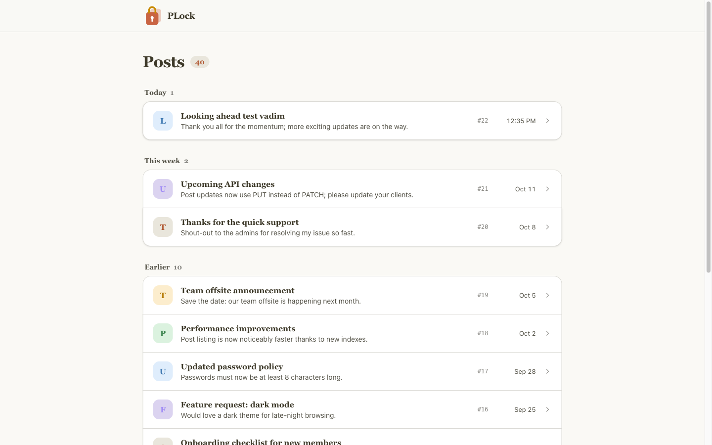
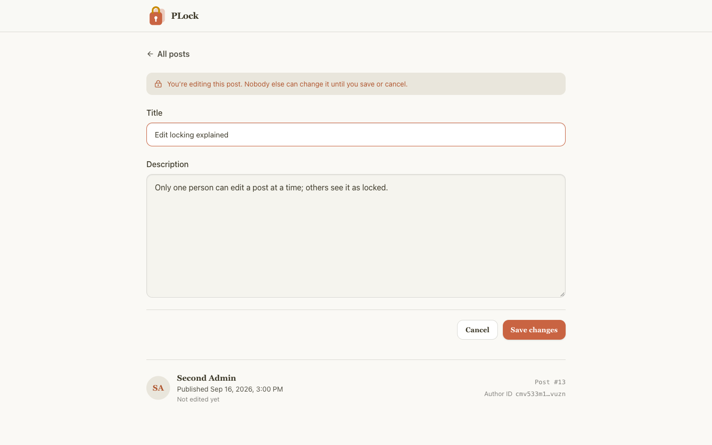
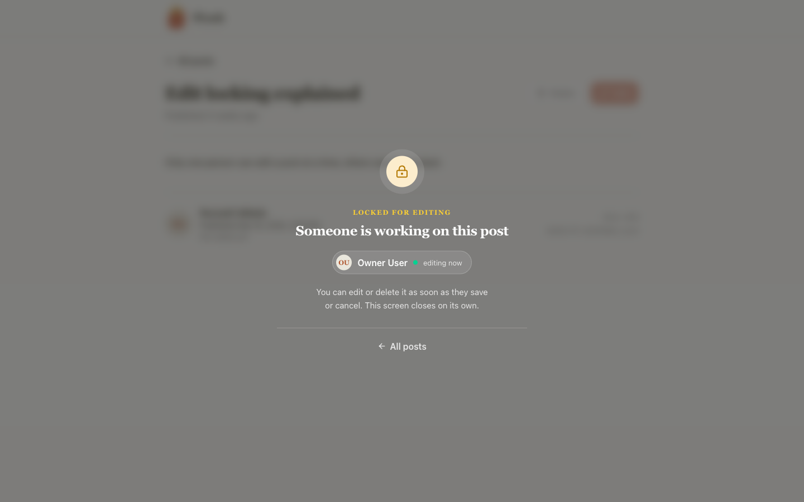
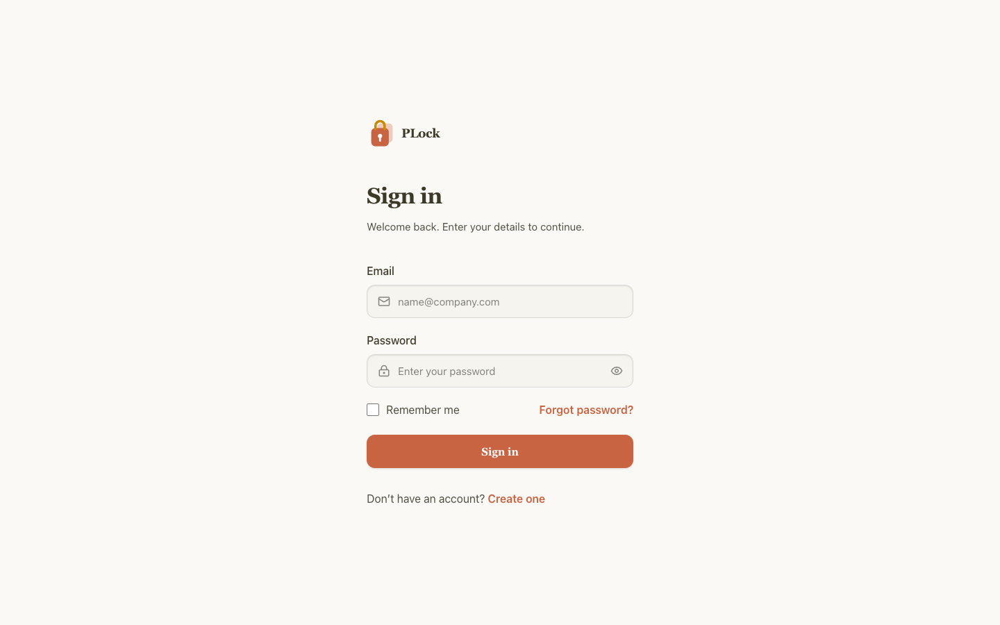
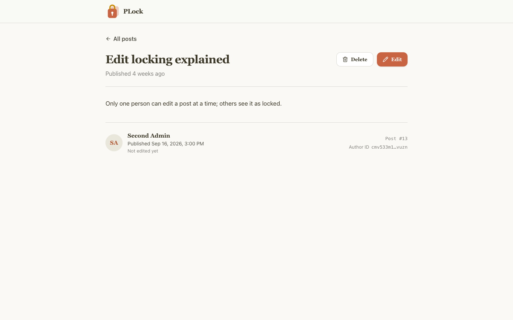
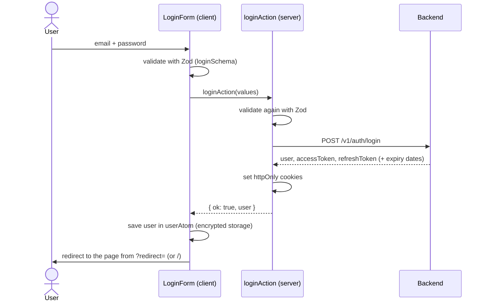

# PLock — Pessimistic Locking Frontend

A Next.js app that demonstrates **pessimistic edit locking** on shared records. Only one person can edit a
post at a time. Everyone else sees, in real time, who holds the lock, and their editing controls are disabled
until the lock is released.



## How the lock works

| 1. Owner starts editing                                | 2. Another user opens the same post                             |
| ------------------------------------------------------ | --------------------------------------------------------------- |
|  |  |

1. A user clicks **Edit**. The client sends `lock:acquire` over a Socket.IO connection (`/locks` namespace).
   The server grants the lock and returns a **lock token**.
2. Every other client watching posts receives `lock:acquired`. On the post page they see a
   _"Locked for editing"_ overlay with the holder's name, and **Edit** / **Delete** are disabled.
3. While the holder types, the client sends `lock:renew` at most once a minute. A lock with no changes
   expires after **5 minutes**.
4. **Save** sends `PUT /v1/posts/:id` with the token in the `x-lock-token` header, so the backend can
   check that the writer still holds the lock.
5. On save, cancel, expiry or disconnect the server broadcasts `lock:released`. Other clients close the
   overlay on their own and can edit again. `record:changed` refreshes the post (or tells viewers it was deleted).

If the holder loses the lock (expired, disconnected), the edit form shows why and asks them to start again.

### Socket events

| Event                         | Direction       | Purpose                                                                  |
| ----------------------------- | --------------- | ------------------------------------------------------------------------ |
| `lock:watch` / `lock:unwatch` | client → server | Subscribe to lock changes for a resource; `watch` returns current locks  |
| `lock:acquire`                | client → server | Request the lock; ack returns the lock and its token, or an error        |
| `lock:renew`                  | client → server | Extend the lock while the holder is active                               |
| `lock:release`                | client → server | Give the lock back (cancel)                                              |
| `lock:acquired`               | server → client | Someone took a lock                                                      |
| `lock:released`               | server → client | A lock ended (`released`, `saved`, `expired`, `disconnected`, `deleted`) |
| `record:changed`              | server → client | A post was updated or deleted                                            |

The socket authenticates with the user's access token, read on the server from an httpOnly cookie
(`getLockToken` server action).

## Post list

- **Fixed page, scrolling list.** The app layout fills the screen (`h-dvh`). The top bar and the _Posts_
  heading stay in place; only the list scrolls, inside its own container, with the scrollbar at the screen edge.
- **Infinite loading.** Posts come from `GET /v1/posts` with `offset` / `limit`. The page size is the number
  of rows that fit in the viewport, and the next page loads as soon as the end of the list comes into view.
  If it fails, a _Try again_ button appears at the bottom.
- **Virtualized.** `@tanstack/react-virtual` renders only the visible rows, using the list container as the
  scroll element, so long lists stay fast.
- **Grouped by day.** Posts are sorted by last edit and grouped under _Today_, _Yesterday_, _This week_ and
  _Earlier_. Each group shows how many posts it holds.

## Screenshots

| Sign in                             | Post detail                                   |
| ----------------------------------- | --------------------------------------------- |
|  |  |

All screenshots live in [`public/images`](public/images).

## Tech stack

- [Next.js 16](https://nextjs.org) (App Router) and React 19
- TypeScript (strict)
- Tailwind CSS v4
- TanStack Query (with `@tanstack/react-virtual` for the infinite post list)
- Socket.IO client
- React Hook Form + Zod
- Axios, Jotai, Framer Motion, Lucide icons
- [Feature-Sliced Design](https://feature-sliced.design), enforced by ESLint boundaries and Steiger
- Bun as package manager

## Getting started

### Requirements

- [Bun](https://bun.sh) 1.4+
- The PLock backend running locally (REST API and Socket.IO server), by default on `http://localhost:4200`

### Setup

```bash
bun install
cp .env.example .env
bun run dev
```

Open [http://localhost:3000](http://localhost:3000) and sign in with one of the demo accounts seeded by
the backend:

| Email               | Password       |
| ------------------- | -------------- |
| `owner@example.com` | `Password123!` |
| `admin@example.com` | `Password123!` |

To see the lock in action, sign in with the two accounts in two browsers (or a normal and a private window)
and open the same post.

### Environment variables

| Variable                     | Required | Description                                                           |
| ---------------------------- | -------- | --------------------------------------------------------------------- |
| `NEXT_PUBLIC_API_URL`        | yes      | Backend REST base URL, e.g. `http://localhost:4200/api`               |
| `NEXT_PUBLIC_SOCKET_URL`     | no       | Socket.IO server URL. Defaults to the origin of `NEXT_PUBLIC_API_URL` |
| `NEXT_PUBLIC_STORAGE_SECRET` | yes      | Key used to encrypt the user profile kept in browser storage          |

## Scripts

| Command                           | Description                                                     |
| --------------------------------- | --------------------------------------------------------------- |
| `bun run dev`                     | Start the dev server                                            |
| `bun run build`                   | Production build                                                |
| `bun run start`                   | Serve the production build                                      |
| `bun run lint`                    | ESLint (including FSD import rules) and Steiger (FSD structure) |
| `bun run lint:fix`                | Fix what can be fixed automatically                             |
| `bun run lint:fsd`                | Steiger only                                                    |
| `bun run format` / `format:check` | Prettier                                                        |

A Husky `pre-commit` hook runs `bun run lint`, so commits with lint or FSD errors are rejected.

## Project structure

```
app/                     Next.js routes (thin, they render pages from src/pages)
  (auth)/login/          Sign in
  (main)/                Post list and post detail (/posts/[id])
proxy.ts                 Auth guard, token refresh, /api proxy that attaches the access token
src/
  app/                   Providers and app layout
  pages/
    login/               Sign-in form
    posts/               Infinite, virtualized post list grouped by day
    post-detail/         Post view, edit form, lock overlay, lock socket
  entities/
    post/                Post types and TanStack Query hooks
    user/                Current user state
  shared/                API client, config, routes, session cookies, UI kit
```

## Authentication

Access and refresh tokens are kept in **httpOnly cookies**, so browser JavaScript never sees them. All token
handling happens on the Next.js server: in a Server Action (sign in) and in `proxy.ts` (route guard, refresh,
API proxy).

### Sign in



1. `useLoginForm` validates the form with `loginSchema` and clears any user left over from an earlier session.
2. `useLoginMutation` calls the `loginAction` Server Action. The action validates the input again, calls
   `POST /v1/auth/login` and writes both tokens as httpOnly, `sameSite=lax` cookies (`secure` in production).
3. The access cookie expires slightly before the token itself (10% of its lifetime, at most 30 seconds),
   so a token never runs out in the middle of a request.
4. Only the user profile goes back to the browser. It is stored in a Jotai atom backed by encrypted
   `localStorage` (`NEXT_PUBLIC_STORAGE_SECRET`).
5. The user is sent back to the page they were on (see [Return to the last page](#return-to-the-last-page)),
   or to the post list if there is none.
6. On failure the backend's message (for example, wrong password) is shown above the form.

### Route guard

`proxy.ts` runs before every page request:

| Situation                                   | Result                                                                  |
| ------------------------------------------- | ----------------------------------------------------------------------- |
| No refresh token                            | Guest: protected pages redirect to `/login?redirect=<page>`             |
| Valid access token                          | Signed in: `/login` redirects to `?redirect=` (or `/`), others render   |
| Access token expired, refresh token present | Tokens are refreshed (see below) and the page renders with the new ones |
| Refresh fails                               | Cookies are cleared and the user is treated as a guest                  |
| URL has `?session=expired`                  | Cookies are cleared and the user lands on `/login`                      |

### API calls and token refresh

- **From the browser**, Axios calls the same-origin path `/api/*`. `proxy.ts` rewrites the request to the
  backend and adds `Authorization: Bearer <accessToken>` from the cookie.
- **From the server** (Server Components and Server Actions), Axios calls the backend directly.
- If the access cookie has expired, `proxy.ts` calls `POST /v1/auth/refresh-token`, writes the new cookies
  and continues the request with the new access token.
- A refresh token works only once, so parallel requests that carry the same refresh token share one refresh
  call (`refreshAuthTokens`). Network and 5xx errors are retried up to 3 times; a 4xx is final.

### Session expiry

If any private API call still returns **401**, the Axios interceptor sends the user to
`/login?session=expired&redirect=<current page>`. `proxy.ts` sees the flag, deletes both cookies and shows the
sign-in page.

### Return to the last page

Whenever the user is sent to sign in, the page they were on travels with them in the `redirect` query parameter:

| Case                              | Login URL                                       |
| --------------------------------- | ----------------------------------------------- |
| Guest opens a protected page      | `/login?redirect=%2Fposts%2F13`                 |
| Session expires (API returns 401) | `/login?session=expired&redirect=%2Fposts%2F13` |

After a successful sign in, `useLoginMutation` reads the parameter and navigates there. The value goes through
`getSafeRedirectPath` (`shared/routes`), which only accepts same-origin paths: anything like `//evil.com`,
`/\evil.com`, an absolute URL or an auth page (`/login`, `/register`, `/forgot-password`) falls back to `/`,
so a crafted link cannot send the user to another site.

### Live connection

The Socket.IO lock connection cannot read httpOnly cookies, so it gets the access token from the
`getLockToken` Server Action and sends it in the socket `auth` payload.
